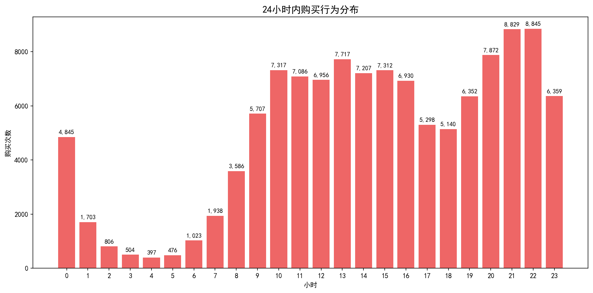
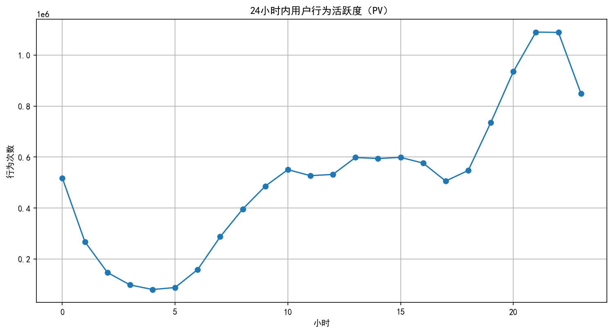
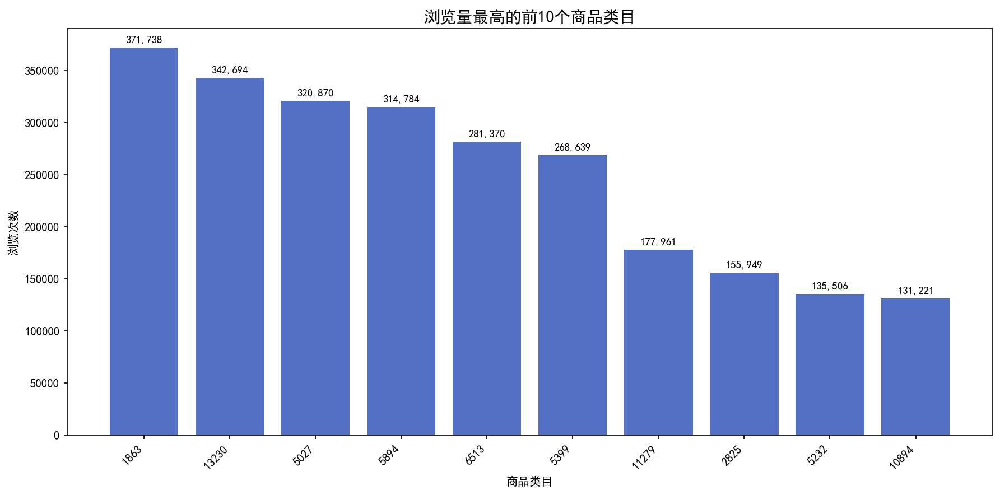

# 电商用户行为数据分析项目 (E-commerce User Analysis)

## 📋 项目简介
本项目旨在通过分析电商用户的浏览、加购、下单等行为数据，深入挖掘用户行为特征与业务潜在问题，从而为运营策略的制定提供强有力的数据支持。

## 📊 核心分析图表

### 1. 商品一级类目浏览 Top 排行榜
展示用户最常浏览的商品类目，反映市场偏好。

### 2. 不同时间段的购买量分析
揭示用户的购买高峰时段，便于优化推送和运营活动。

### 3. 24小时页面浏览量(PV)趋势
分析全天用户活跃度变化，为流量高峰期的资源调度提供依据。

### 4. 用户转化漏斗分析
分析从“浏览”到“支付”各阶段的转化率，定位用户流失最严重的环节。

